# 📚 Gestion de livres — Angular + Laravel

Application web de gestion de livres et d'auteurs :

- **books-api** : API REST en Laravel 10 (backend).
- **books-front** : application Angular 16 (frontend).

Ce document explique comment installer, configurer et utiliser le projet sur un nouveau PC Windows.

---

## Sommaire

1. [Présentation du projet](#1-présentation-du-projet)
2. [Installation](#2-installation)
3. [Base de données](#3-base-de-données)
4. [Compte administrateur](#4-compte-administrateur)
5. [Authentification](#5-authentification)
6. [Google OAuth](#6-google-oauth)
7. [SMTP et emails](#7-smtp-et-emails)
8. [Filtres et pagination](#8-filtres-et-pagination)
9. [API REST](#9-api-rest)
10. [Captures d'écran](#10-captures-décran)
11. [Dépannage](#11-dépannage)
12. [Livraison](#12-livraison)
13. [Gestion des rôles et des permissions](#13-gestion-des-rôles-et-des-permissions)

---

## 1. Présentation du projet

### Fonctionnalités implémentées

**Visiteur (sans compte)**

- Voir la liste des livres avec image, auteur et année.
- Rechercher un livre par titre.
- Filtrer les livres par auteur.
- Naviguer entre les pages (10 livres par page).

**Utilisateur connecté**

- Inscription avec code de vérification (OTP) envoyé par email.
- Connexion par email et mot de passe.
- Connexion avec Google.
- Mot de passe oublié : code OTP par email puis nouveau mot de passe.
- Voir le détail d'un livre (`/books/:id`).
- Déconnexion.

**Administrateur**

- Redirection vers le tableau de bord (`/admin`) après la connexion.
- Livres : liste avec recherche, filtre par auteur et pagination, ajout, modification avec les anciennes données pré-remplies, suppression.
- Upload d'une image de couverture (JPG, PNG ou WebP, 2 Mo maximum).
- Auteurs : liste avec recherche et pagination, ajout, modification, suppression.
- Boutons « Ajouter un livre » et « Ajouter un auteur » sur la page publique `/books`.
- Barre latérale admin avec liens et bouton de déconnexion.

### Technologies utilisées

| Partie | Technologie | Version (voir `composer.json` / `package.json`) |
|---|---|---|
| Backend | PHP | ^8.1 |
| Backend | Laravel | ^10.0 |
| Backend | Laravel Sanctum (tokens API) | ^3.3 |
| Backend | Laravel Socialite (Google) | ^5.31 |
| Backend | L5-Swagger (documentation API) | ^8.6 |
| Backend | MySQL | — |
| Frontend | Angular (composants standalone) | ^16.2 |
| Frontend | Tailwind CSS | ^3.4 |
| Frontend | ngx-cookie-service | ^16.1 |
| Frontend | Font Awesome (icônes) | ^6.7 |

---

## 2. Installation

### 2.1 Prérequis (Windows)

| Outil | Rôle | Vérifier avec |
|---|---|---|
| PHP 8.1 ou plus | Lancer Laravel | `php -v` |
| Composer | Installer les dépendances PHP | `composer --version` |
| MySQL (XAMPP, Laragon ou MySQL Server) | Base de données | phpMyAdmin ou `mysql --version` |
| Node.js + npm | Lancer Angular | `node -v` et `npm -v` |
| Git (optionnel) | Récupérer le projet | `git --version` |

Extensions PHP à activer dans `php.ini` : `pdo_mysql`, `mbstring`, `openssl`, `fileinfo` (nécessaire pour l'upload d'images), `curl`.

> Avec XAMPP, le fichier `php.ini` se trouve dans `C:\xampp\php\php.ini`. Retirez le `;` devant `extension=pdo_mysql`, `extension=fileinfo`, etc., puis redémarrez le terminal.

### 2.2 Backend (books-api)

Ouvrez un terminal dans le dossier `books-api` :

```bash
cd books-api
composer install
copy .env.example .env
php artisan key:generate
```

Configurez ensuite le fichier `.env` (voir [2.4](#24-configuration-des-fichiers-env)).

Créez la base de données `book-shop` dans phpMyAdmin (interclassement `utf8mb4_unicode_ci`), ou en ligne de commande :

```sql
CREATE DATABASE `book-shop` CHARACTER SET utf8mb4 COLLATE utf8mb4_unicode_ci;
```

Lancez les migrations, le lien de stockage des images et les seeders :

```bash
php artisan migrate
php artisan storage:link
php artisan db:seed
```

> **Autre solution :** au lieu de `migrate` et `db:seed`, importez l'export fourni dans `exports/book-shop.sql` (voir [3.5](#35-import-de-la-base)). `php artisan storage:link` reste nécessaire.

Démarrez le serveur :

```bash
php artisan serve
```

L'API est disponible sur **http://127.0.0.1:8000/api**.

### 2.3 Frontend (books-front)

Ouvrez un **deuxième** terminal dans le dossier `books-front` :

```bash
cd books-front
npm install
npm start
```

L'application est disponible sur **http://localhost:4200**.

> ⚠️ Ouvrez toujours le frontend avec `http://localhost:4200` (et pas `127.0.0.1:4200`). La connexion Google redirige vers `localhost:4200`, et les cookies ne sont pas partagés entre `localhost` et `127.0.0.1`.

### 2.4 Configuration des fichiers `.env`

#### Backend : `books-api/.env`

Le fichier `books-api/.env.example` contient toutes les variables utilisées. Copiez-le en `.env`, puis remplacez les valeurs d'exemple :

```env
APP_URL=http://127.0.0.1:8000

DB_CONNECTION=mysql
DB_HOST=127.0.0.1
DB_PORT=3306
DB_DATABASE=book-shop
DB_USERNAME=root
DB_PASSWORD=

MAIL_MAILER=smtp
MAIL_HOST=smtp.gmail.com
MAIL_PORT=587
MAIL_USERNAME=votre.adresse@gmail.com
MAIL_PASSWORD=mot_de_passe_application_gmail
MAIL_ENCRYPTION=tls
MAIL_FROM_ADDRESS="votre.adresse@gmail.com"
MAIL_FROM_NAME="${APP_NAME}"

GOOGLE_CLIENT_ID=votre-client-id.apps.googleusercontent.com
GOOGLE_CLIENT_SECRET=votre-client-secret
GOOGLE_REDIRECT_URI=http://127.0.0.1:8000/auth/google/callback
```

> Les valeurs ci-dessus sont des exemples. Ne mettez jamais vos vrais mots de passe ou secrets dans `.env.example` ni dans le README.

#### Frontend : pas de fichier `.env`

Angular n'utilise **pas** de fichier `.env` dans ce projet, et il n'y a pas de dossier `src/environments`. Les adresses sont écrites directement dans le code :

| Fichier | Valeur | Rôle |
|---|---|---|
| `books-front/src/app/core/config/api.config.ts` | `baseUrl: 'http://127.0.0.1:8000/api'` | Adresse de l'API |
| `books-front/src/app/pages/login/login.component.ts` | `http://127.0.0.1:8000/auth/google` | Bouton « Se connecter avec Google » |

Si le backend tourne sur une autre adresse, modifiez ces deux fichiers.

---

## 3. Base de données

### 3.1 Tables

| Table | Rôle |
|---|---|
| `users` | Utilisateurs : nom, email, mot de passe, `role` (`admin` ou `user`), `google_id`, champs OTP |
| `authors` | Auteurs : `name` |
| `books` | Livres : `title`, `year`, `image`, `author_id` |
| `personal_access_tokens` | Tokens Sanctum créés à la connexion |
| `password_reset_tokens` | Table Laravel par défaut, **non utilisée** (le projet utilise des OTP dans `users`) |
| `failed_jobs` | Table Laravel par défaut |

### 3.2 Relations

- Un **auteur** possède plusieurs **livres** (`Author::books()` → `hasMany`).
- Un **livre** appartient à un **auteur** (`Book::author()` → `belongsTo`).
- La clé étrangère `books.author_id` utilise `cascadeOnDelete()` : **supprimer un auteur supprime aussi tous ses livres**.
- Un **utilisateur** possède plusieurs **tokens** Sanctum (trait `HasApiTokens`).

### 3.3 MCD (schéma entité-relation)

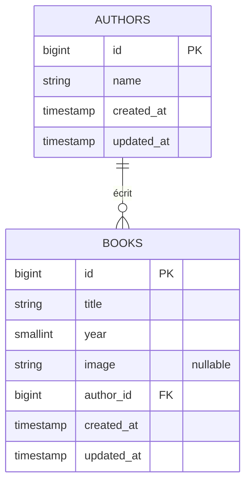

Version texte :

```
AUTHORS (1) ───────< (0..n) BOOKS

```

### 3.4 Export SQL

Un export complet de la base est fourni dans **[`exports/book-shop.sql`](exports/book-shop.sql)**, à la racine du projet.

| Contenu | Détail |
|---|---|
| Origine | Export phpMyAdmin de la base `book-shop` (MySQL 8.4) |
| Structure | Les 7 tables : `authors`, `books`, `users`, `personal_access_tokens`, `password_reset_tokens`, `failed_jobs`, `migrations` |
| `authors` | 8 auteurs |
| `books` | 20 livres, avec le chemin de leur image (`books/....jpg`) |
| `users` | 1 compte : l'admin `admin@gmail.com` (rôle `admin`, email vérifié) |
| `personal_access_tokens` | 2 tokens Sanctum (stockés hachés) |
| `migrations` | Les 10 migrations, marquées comme déjà exécutées |

Ce fichier est une alternative aux migrations et aux seeders : importez-le **ou** lancez `php artisan migrate` + `php artisan db:seed`, mais pas les deux (voir [3.5](#35-import-de-la-base)).

Pour refaire un export (exemple avec XAMPP) :

```bash
C:\xampp\mysql\bin\mysqldump.exe -u root -p book-shop > exports\book-shop.sql
```

Ou dans phpMyAdmin : sélectionnez la base `book-shop` → onglet **Exporter** → **Exécuter**.

> ⚠️ Un export contient les emails, les mots de passe hachés et les tokens de connexion (`personal_access_tokens`). Videz la table `personal_access_tokens` et retirez les comptes personnels avant de partager le fichier.

### 3.5 Import de la base

Pour utiliser `exports/book-shop.sql` à la place des migrations et des seeders :

1. Créez la base vide `book-shop` (voir [2.2](#22-backend-books-api)).
2. Importez le fichier, depuis la racine du projet :

```bash
C:\xampp\mysql\bin\mysql.exe -u root -p book-shop < exports\book-shop.sql
```

Ou dans phpMyAdmin : base `book-shop` → onglet **Importer** → choisir `exports/book-shop.sql` → **Exécuter**.

3. **Ne lancez pas** `php artisan migrate` ni `php artisan db:seed` : les tables et les données existent déjà.
4. Lancez `php artisan storage:link` pour que les images soient accessibles.
5. Connectez-vous avec `admin@gmail.com` / `Admin@123456`.

> ⚠️ Les images ne sont **pas** dans le fichier SQL : il ne contient que leur chemin (`books/germinal.jpg`, etc.). Copiez aussi le dossier `books-api/storage/app/public/books/`, ou lancez `php artisan db:seed --class=BookSeeder` pour retélécharger les couvertures manquantes.

### 3.6 Données de démonstration

Le seeder `database/seeders/BookSeeder.php` crée :

- **8 auteurs** : Victor Hugo, Albert Camus, Antoine de Saint-Exupéry, Émile Zola, Gustave Flaubert, Jules Verne, George Orwell, Naguib Mahfouz ;
- **20 livres** (2 pages de 10, pour tester la pagination) ;
- les **couvertures**, téléchargées depuis [Open Library](https://openlibrary.org) et enregistrées dans `storage/app/public/books/`.

```bash
php artisan db:seed --class=BookSeeder
```

- Une connexion Internet est nécessaire pour télécharger les couvertures.
- Si Open Library ne trouve pas un titre, le livre est créé sans image.
- Le seeder utilise `firstOrCreate` : le relancer ne crée pas de doublons et ajoute seulement les images manquantes.

Pour **tout effacer et recréer** la base :

```bash
php artisan migrate:fresh --seed
```

> ⚠️ Cette commande supprime **toutes** les données, y compris les comptes utilisateurs. Il faut ensuite se reconnecter dans l'application : l'ancien token n'existe plus.

---

## 4. Compte administrateur

### Seeder

Le compte admin est créé par `database/seeders/AdminSeeder.php`, appelé par `DatabaseSeeder.php`.

### Identifiants de démonstration

| Champ | Valeur |
|---|---|
| Email | `admin@gmail.com` |
| Mot de passe | `Admin@123456` |
| Rôle | `admin` |
| Email vérifié | oui (`email_verified_at` = date du seed) |

> Ces identifiants servent uniquement à la démonstration en local. Changez-les avant toute mise en ligne.

### Rôle admin

- La colonne `users.role` vaut `admin` ou `user` (`user` par défaut).
- Le modèle `User` ajoute l'attribut calculé `is_admin` (`getIsAdminAttribute()`), qui vaut `true` quand `role === 'admin'`. Le middleware `IsAdmin` et les policies `BookPolicy` et `AuthorPolicy` l'utilisent.
- Le rôle n'est pas modifiable depuis l'application. Pour donner le rôle admin à un utilisateur existant :

```bash
php artisan tinker --execute="App\Models\User::where('email', 'utilisateur@example.com')->update(['role' => 'admin']);"
```

### Email vérifié

La connexion est refusée tant que `email_verified_at` est vide. Le seeder remplit ce champ, donc l'admin peut se connecter directement.

> ⚠️ `AdminSeeder` cherche le compte avec **tous** ses champs, y compris le mot de passe haché, qui change à chaque exécution. Relancer `php artisan db:seed` sur une base qui contient déjà l'admin provoque une erreur de doublon sur l'email. Sur une base existante, lancez seulement `php artisan db:seed --class=BookSeeder`.

---

## 5. Authentification

### 5.1 Inscription et vérification d'email

1. `/register` : nom, email, mot de passe (8 caractères minimum) et confirmation.
2. L'API crée le compte (`POST /api/register`) et envoie un **code OTP à 6 chiffres** par email, valable **10 minutes**.
3. Le frontend redirige vers `/verify-email?email=...`.
4. L'utilisateur saisit le code (`POST /api/verify-email`) : `email_verified_at` est rempli.
5. Redirection vers `/login`.

### 5.2 Connexion

1. `/login` envoie `POST /api/login`.
2. L'API vérifie le mot de passe et que l'email est vérifié.
3. Elle renvoie un **token Sanctum** et l'utilisateur, avec son `role`.
4. Le frontend enregistre deux cookies (`auth.service.ts`) :

| Cookie | Contenu | Durée |
|---|---|---|
| `token` | Token Sanctum (format `1|abc...`, ce n'est **pas** un JWT) | 1 jour |
| `role` | `admin` ou `user` | 1 jour |

5. Redirection vers `/admin` pour un admin, vers `/books` sinon.

> Les cookies sont créés en JavaScript (pas `HttpOnly`), avec `path=/` et `SameSite=Lax`. Côté Laravel, les tokens n'expirent pas (`config/sanctum.php` → `'expiration' => null`).

### 5.3 Mot de passe oublié

1. `/forgot-password` : saisie de l'email → `POST /api/forgot-password` → envoi d'un code OTP (10 minutes).
2. Redirection vers `/reset-password?email=...`.
3. Saisie du code et du nouveau mot de passe → `POST /api/reset-password`.
4. Redirection vers `/login`.

> La page `/reset-password-otp` existe mais n'est pas utilisée dans ce parcours : `/forgot-password` redirige directement vers `/reset-password`.

### 5.4 Déconnexion

Les boutons « Déconnexion » de la navbar et de la barre latérale admin suppriment les cookies `token` et `role`, puis redirigent vers `/login`.

> ⚠️ Le frontend n'appelle pas `POST /api/logout`. Le token est supprimé du navigateur mais reste valide en base, dans `personal_access_tokens`.

### 5.5 Interceptor Angular

`src/app/core/interceptors/auth.interceptor.ts` ajoute automatiquement à chaque requête HTTP, si un token existe :

```
Authorization: Bearer <token>
Accept: application/json
```

Il est déclaré dans `src/app/app.config.ts` avec `provideHttpClient(withInterceptors([authInterceptor]))`.

### 5.6 Guards et routes protégées (Angular)

| Guard | Fichier | Condition | Sinon |
|---|---|---|---|
| `authGuard` | `src/app/guards/auth.guard.ts` | Cookie `token` présent | Redirection `/login` |
| `adminGuard` | `src/app/guards/admin.guard.ts` | Cookie `token` présent **et** cookie `role` = `admin` | `/login` ou `/books` |

| Route Angular | Protection |
|---|---|
| `/books`, `/login`, `/register`, `/verify-email`, `/forgot-password`, `/reset-password`, `/reset-password-otp`, `/auth/callback` | Publique |
| `/books/:id` | `authGuard` |
| `/admin`, `/admin/books`, `/admin/books/new`, `/admin/books/:id/edit`, `/admin/authors`, `/admin/authors/new`, `/admin/authors/:id/edit` | `adminGuard` |

> Les guards Angular ne servent qu'à l'affichage. La vraie sécurité est assurée par l'API.

### 5.7 Autorisations côté API

- `auth:sanctum` : token valide obligatoire (sinon `401 Unauthenticated.`).
- `is_admin` (`app/Http/Middleware/IsAdmin.php`) : rôle admin obligatoire (sinon `403 Forbidden. Admin access required.`).
- Policies `BookPolicy` et `AuthorPolicy` : vérifient `is_admin` pour `create`, `update` et `delete`.

---

## 6. Google OAuth

### 6.1 Configuration de Google Cloud Console

1. Ouvrez https://console.cloud.google.com et connectez-vous.
2. Créez un projet : menu du haut → **Nouveau projet** → nom (exemple : `books-app`) → **Créer**.
3. **API et services → Écran de consentement OAuth** :
   - Type d'utilisateur : **Externe** ;
   - Nom de l'application, email d'assistance et email du développeur ;
   - Champs d'application (scopes) : `email`, `profile`, `openid` ;
   - **Utilisateurs test** : ajoutez les adresses Gmail qui pourront se connecter tant que l'application est en mode « Test ».
4. **API et services → Identifiants → Créer des identifiants → ID client OAuth** :
   - Type d'application : **Application Web** ;
   - **Origines JavaScript autorisées** : `http://127.0.0.1:8000`
   - **URI de redirection autorisés** : `http://127.0.0.1:8000/auth/google/callback`
5. Cliquez sur **Créer**. Google affiche le **Client ID** et le **Client Secret** : copiez-les.

### 6.2 Variables `.env` Laravel

```env
GOOGLE_CLIENT_ID=votre-client-id.apps.googleusercontent.com
GOOGLE_CLIENT_SECRET=votre-client-secret
GOOGLE_REDIRECT_URI=http://127.0.0.1:8000/auth/google/callback
```

Elles sont lues dans `config/services.php` (clé `google`). Après une modification :

```bash
php artisan config:clear
```

> `GOOGLE_REDIRECT_URI` doit être **exactement** identique à l'URI déclarée dans Google Cloud Console (même `127.0.0.1`, même port, pas de `/` final).

### 6.3 Configuration Angular

- Le bouton Google de `/login` redirige vers `http://127.0.0.1:8000/auth/google` (`login.component.ts`, méthode `loginWithGoogle()`).
- La route `/auth/callback` (`google-callback.component.ts`) lit le token dans l'URL et l'enregistre dans le cookie `token`.

### 6.4 Fonctionnement de la redirection

```
Angular /login
   └─► http://127.0.0.1:8000/auth/google              (routes/web.php → GoogleAuthController@redirect)
         └─► Page de connexion Google (choix du compte)
               └─► http://127.0.0.1:8000/auth/google/callback   (GoogleAuthController@callback)
                     ├─ cherche l'utilisateur par google_id, puis par email
                     ├─ sinon crée un compte (email considéré comme vérifié)
                     ├─ crée un token Sanctum
                     └─► http://localhost:4200/auth/callback?token=...
                           └─ Angular enregistre le cookie "token" puis redirige vers /books
```

Si l'email est déjà lié à un **autre** compte Google, l'API redirige vers `http://localhost:4200/login?error=google_account_conflict`.

Les adresses `http://localhost:4200` sont écrites en dur dans `app/Http/Controllers/Api/GoogleAuthController.php`.

### 6.5 Récupération du rôle utilisateur

⚠️ **Non implémenté.** Le callback Google ne transmet que le token, pas le rôle, donc le cookie `role` n'est pas créé. Conséquences :

- un admin connecté par Google ne voit ni les boutons admin ni la page `/admin` ;
- un admin doit se connecter avec email et mot de passe.

Il n'existe pas de route API du type `/api/user` pour récupérer le rôle après coup.

### 6.6 Dépannage OAuth

| Erreur | Cause | Solution |
|---|---|---|
| `Error 400: redirect_uri_mismatch` | L'URI de callback ne correspond pas | Vérifiez que `GOOGLE_REDIRECT_URI` et l'URI dans Google Cloud Console sont identiques, puis lancez `php artisan config:clear` |
| `Error 401: invalid_client` | Client ID ou Secret faux | Recopiez les valeurs depuis Google Cloud Console |
| `Error 403: access_denied` | Compte non autorisé en mode « Test » | Ajoutez l'adresse dans **Utilisateurs test** |
| `InvalidStateException` (Laravel) | Session perdue entre l'aller et le retour | Utilisez la même adresse (`127.0.0.1:8000`) partout ; vérifiez que `storage/framework/sessions` est accessible en écriture |
| Retour sur `/login?error=google_account_conflict` | Email déjà lié à un autre compte Google | Utilisez le bon compte Google. Le message n'est pas affiché sur la page de connexion |
| Connecté mais pas d'accès admin | Le rôle n'est pas transmis par Google | Connectez-vous avec email et mot de passe (voir [6.5](#65-récupération-du-rôle-utilisateur)) |
| `cURL error 60: SSL certificate problem` | Certificats manquants pour PHP sous Windows | Téléchargez `cacert.pem` (https://curl.se/ca/cacert.pem) et indiquez son chemin dans `php.ini` : `curl.cainfo` et `openssl.cafile` |

---

## 7. SMTP et emails

### 7.1 Variables `MAIL_*`

| Variable | Exemple | Rôle |
|---|---|---|
| `MAIL_MAILER` | `smtp` | Mode d'envoi (`log` pour tester sans envoyer) |
| `MAIL_HOST` | `smtp.gmail.com` | Serveur SMTP |
| `MAIL_PORT` | `587` | Port |
| `MAIL_USERNAME` | `votre.adresse@gmail.com` | Identifiant SMTP |
| `MAIL_PASSWORD` | `mot_de_passe_application_gmail` | Mot de passe SMTP |
| `MAIL_ENCRYPTION` | `tls` | Chiffrement |
| `MAIL_FROM_ADDRESS` | `"votre.adresse@gmail.com"` | Expéditeur |
| `MAIL_FROM_NAME` | `"${APP_NAME}"` | Nom de l'expéditeur |

### 7.2 Configurer Gmail

1. Activez la **validation en deux étapes** sur le compte Google.
2. Ouvrez https://myaccount.google.com/apppasswords et créez un **mot de passe d'application**.
3. Mettez ces 16 caractères dans `MAIL_PASSWORD`, sans espaces. Votre mot de passe Gmail normal ne fonctionne pas.
4. Lancez `php artisan config:clear`.

Un autre fournisseur SMTP (Mailtrap, Brevo, etc.) fonctionne aussi : remplacez `MAIL_HOST`, `MAIL_PORT`, `MAIL_USERNAME`, `MAIL_PASSWORD` et `MAIL_ENCRYPTION` par les valeurs qu'il fournit.

### 7.3 Emails implémentés

| Classe | Sujet | Envoyé par | Contenu |
|---|---|---|---|
| `app/Mail/VerifyEmailOtpMail.php` | `Your email verification code` | `POST /api/register` | Code à 6 chiffres, valable 10 minutes |
| `app/Mail/PasswordResetOtpMail.php` | `Your password reset code` | `POST /api/forgot-password` | Code à 6 chiffres, valable 10 minutes |

- Les emails sont en HTML simple (`htmlString`), sans template Blade, et rédigés en anglais.
- Ils sont envoyés immédiatement (`QUEUE_CONNECTION=sync`), sans file d'attente.
- Il n'existe pas de bouton « Renvoyer le code ».

### 7.4 Diagnostic des erreurs

**Tester sans vrai SMTP** : mettez `MAIL_MAILER=log` dans `.env`, puis lancez `php artisan config:clear`. Les emails, avec le code OTP, sont alors écrits dans `books-api/storage/logs/laravel.log`.

| Message | Cause probable | Solution |
|---|---|---|
| `Failed to register account.` | L'email n'a pas pu être envoyé | Vérifiez les variables `MAIL_*` et lisez `storage/logs/laravel.log` |
| `Failed to send password reset code.` | Même cause | Même solution |
| `535 Username and Password not accepted` | Mot de passe Gmail normal utilisé | Utilisez un mot de passe d'application |
| `Connection could not be established` | Port ou chiffrement faux, ou pare-feu | Utilisez `587` + `tls` (ou `465` + `ssl`) |
| `Email address already exists.` après un échec d'envoi | Le compte est créé **avant** l'envoi de l'email | Supprimez le compte (voir ci-dessous) puis réinscrivez-vous |

Supprimer un compte non vérifié :

```bash
php artisan tinker --execute="App\Models\User::where('email', 'utilisateur@example.com')->whereNull('email_verified_at')->delete();"
```

---

## 8. Filtres et pagination

### 8.1 Livres (pagination côté backend)

`GET /api/books` accepte ces paramètres :

| Paramètre | Effet | Code |
|---|---|---|
| `search` | Titre contenant le texte (`LIKE %texte%`) | `BookService::getBooks()` |
| `author` | Nom d'auteur contenant le texte (`LIKE %texte%`) | `BookService::getBooks()` |
| `page` | Numéro de page | `paginate(10)` |

- 10 livres par page, triés du plus récent au plus ancien (`orderByDesc('id')`).
- `withQueryString()` garde `search` et `author` dans les liens `links.next` et `links.prev`.

Exemples :

```
http://127.0.0.1:8000/api/books
http://127.0.0.1:8000/api/books?page=2
http://127.0.0.1:8000/api/books?search=peste
http://127.0.0.1:8000/api/books?author=Victor%20Hugo
http://127.0.0.1:8000/api/books?search=les&author=Hugo&page=1
```

Réponse (format Laravel `ResourceCollection`, abrégé) :

```json
{
  "data": [
    {
      "id": 20,
      "title": "Les Fils de la médina",
      "year": 1959,
      "image": "http://127.0.0.1:8000/storage/books/les-fils-de-la-medina.jpg",
      "author": { "id": 8, "name": "Naguib Mahfouz" },
      "created_at": "...",
      "updated_at": "..."
    }
  ],
  "links": { "first": "...?page=1", "last": "...?page=2", "prev": null, "next": "...?page=2" },
  "meta": { "current_page": 1, "last_page": 2, "per_page": 10, "total": 20 }
}
```

### 8.2 Frontend livres

Pages : `/books` (`book-list`) et `/admin/books` (`admin-book-list`).

- Composant `app-search` (`src/app/shared/search`) : champ « Rechercher un livre... » et liste « Tous les auteurs ».
- Composant `app-pagination` (`src/app/shared/pagination`) : navigation entre les pages.
- Chaque changement de recherche ou d'auteur **remet la page à 1** et recharge les livres. Les filtres et la page sont envoyés ensemble à l'API (`page`, `search`, `author`).
- La liste des auteurs du filtre vient de `GET /api/authors`.
- La recherche est envoyée à chaque frappe, sans délai.

### 8.3 Auteurs (pagination côté frontend)

`GET /api/authors` renvoie **tous** les auteurs, sans pagination ni filtre.

Sur la page `/admin/authors` (`author-list.component.ts`) :

- le champ « Rechercher un auteur... » filtre par nom dans le navigateur ;
- la pagination (10 par page) est calculée dans le navigateur avec `app-pagination` ;
- une nouvelle recherche remet la page à 1.

---

## 9. API REST

Base : `http://127.0.0.1:8000/api`. Toutes les réponses sont en JSON (middleware `ForceJsonResponse`).

Une documentation Swagger générée par L5-Swagger est disponible sur **http://127.0.0.1:8000/api/documentation** (fichier `storage/api-docs/api-docs.json`).

### 9.1 Routes

| Méthode | Route | Paramètres | Authentification |
|---|---|---|---|
| POST | `/register` | `name`, `email`, `password`, `password_confirmation` | Non |
| POST | `/verify-email` | `email`, `otp` (6 chiffres) | Non |
| POST | `/login` | `email`, `password` | Non |
| POST | `/forgot-password` | `email` | Non |
| POST | `/reset-password` | `email`, `otp`, `password`, `password_confirmation` | Non |
| GET | `/books` | `page`, `search`, `author` (optionnels) | Non |
| GET | `/authors` | — | Non |
| GET | `/books/{id}` | — | Token |
| POST | `/logout` | — | Token |
| POST | `/books` | `title`, `year` (1000–9999), `author_id`, `image` (optionnel) en `multipart/form-data` | Token + admin |
| PUT | `/books/{id}` | Mêmes champs, tous optionnels | Token + admin |
| DELETE | `/books/{id}` | — | Token + admin |
| GET | `/authors/{id}` | — | Token + admin |
| POST | `/authors` | `name` (unique) | Token + admin |
| PUT | `/authors/{id}` | `name` (unique) | Token + admin |
| DELETE | `/authors/{id}` | — | Token + admin |

Routes web (hors `/api`) :

| Méthode | Route | Rôle |
|---|---|---|
| GET | `/auth/google` | Redirection vers Google |
| GET | `/auth/google/callback` | Retour de Google, création du token |

> Pour modifier un livre **avec une image**, PHP ne lit pas les fichiers envoyés en `PUT multipart`. Le frontend envoie donc `POST /books/{id}` avec le champ `_method=PUT` (`book.service.ts`).

### 9.2 Exemples de requêtes

Sous Windows PowerShell, utilisez `curl.exe` (et non `curl`, qui est un alias PowerShell).

Connexion :

```bash
curl.exe -X POST http://127.0.0.1:8000/api/login -H "Accept: application/json" -H "Content-Type: application/json" -d "{\"email\":\"admin@gmail.com\",\"password\":\"Admin@123456\"}"
```

Réponse :

```json
{
  "message": "Login successful.",
  "user": { "id": 1, "name": "Admin", "email": "admin@gmail.com", "role": "admin" },
  "token": "1|xxxxxxxxxxxxxxxxxxxxxxxx"
}
```

Liste des livres filtrée :

```bash
curl.exe "http://127.0.0.1:8000/api/books?search=peste&page=1" -H "Accept: application/json"
```

Ajouter un auteur (admin) :

```bash
curl.exe -X POST http://127.0.0.1:8000/api/authors -H "Accept: application/json" -H "Authorization: Bearer VOTRE_TOKEN" -H "Content-Type: application/json" -d "{\"name\":\"Molière\"}"
```

Ajouter un livre avec une image (admin) :

```bash
curl.exe -X POST http://127.0.0.1:8000/api/books -H "Accept: application/json" -H "Authorization: Bearer VOTRE_TOKEN" -F "title=Le Misanthrope" -F "year=1666" -F "author_id=1" -F "image=@C:\chemin\vers\couverture.jpg"
```

Modifier un livre (admin) :

```bash
curl.exe -X POST http://127.0.0.1:8000/api/books/1 -H "Accept: application/json" -H "Authorization: Bearer VOTRE_TOKEN" -F "_method=PUT" -F "title=Nouveau titre"
```

Supprimer un livre (admin) :

```bash
curl.exe -X DELETE http://127.0.0.1:8000/api/books/1 -H "Accept: application/json" -H "Authorization: Bearer VOTRE_TOKEN"
```

### 9.3 Codes de réponse

| Code | Signification |
|---|---|
| 200 / 201 | Succès |
| 401 | Token absent ou invalide (`Unauthenticated.`) |
| 403 | Utilisateur non admin (`Forbidden. Admin access required.`) |
| 404 | Livre ou auteur introuvable |
| 422 | Données invalides (détails dans `errors`) ou erreur d'inscription |
| 500 | Voir la remarque ci-dessous |

> ⚠️ Seules `RegisterException` et les erreurs d'authentification ont un code HTTP dédié (`app/Exceptions/Handler.php`). Les autres erreurs métier (`LoginException`, `ForgotPasswordException`, `BookException`, `AuthorException`, `LogoutException`) répondent avec un code **500**. Par exemple, un mauvais mot de passe renvoie un 500 avec le message `Invalid email or password.`. Avec `APP_DEBUG=false`, le message serait remplacé par `Server Error`.

---

## 10. Captures d'écran

Captures réelles de l'application en fonctionnement (backend `php artisan serve` + frontend `npm start`, données du `BookSeeder`). Elles ont été prises avec Google Chrome en mode headless, piloté par `puppeteer-core`, en fenêtre de 1440 px de large. La connexion admin a été faite avec le vrai formulaire de `/login`.

Toutes les images se trouvent dans [`docs/screenshots/`](docs/screenshots/).

### 10.1 Connexion

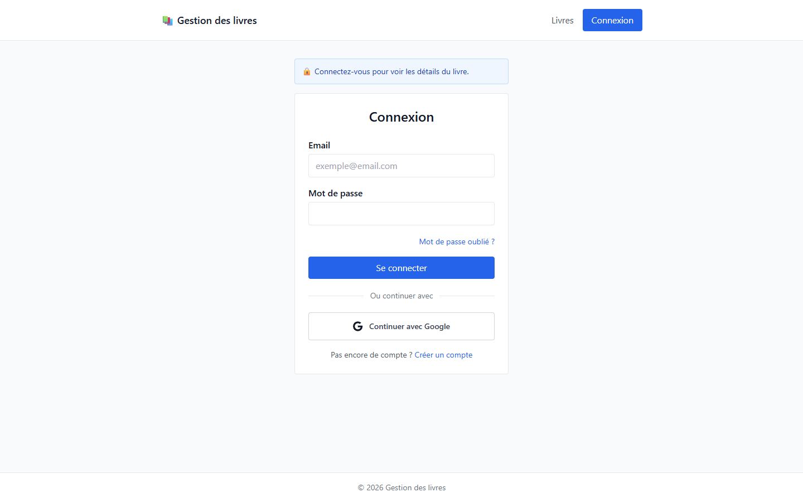

*`/login` : connexion par email et mot de passe, lien « Mot de passe oublié ? », bouton Google et lien d'inscription.*

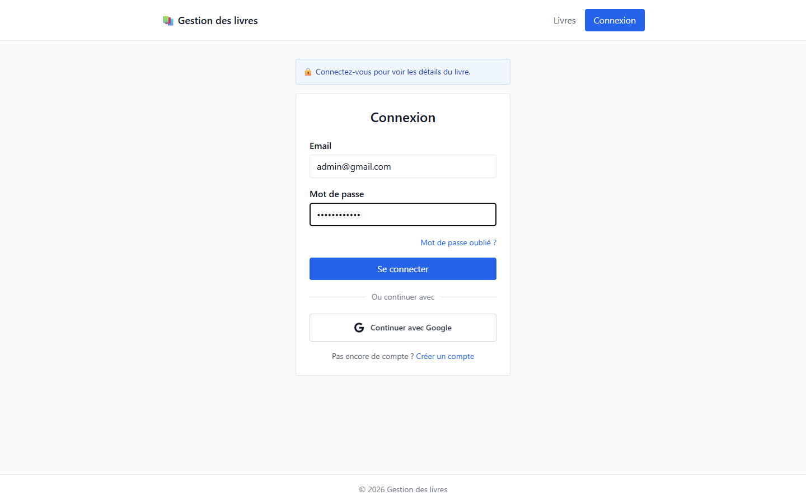

*Formulaire rempli avec le compte de démonstration `admin@gmail.com`.*

### 10.2 Liste des livres

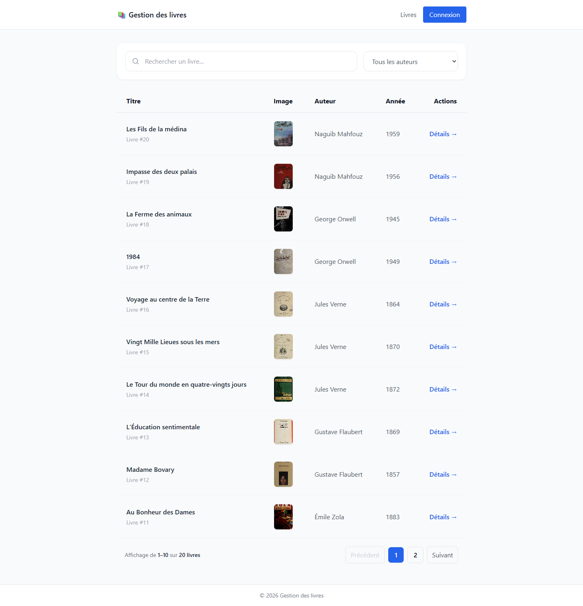

*`/books` vu par un visiteur : 10 livres par page, avec couverture, auteur, année et lien « Détails ».*

### 10.3 Recherche, filtres et pagination

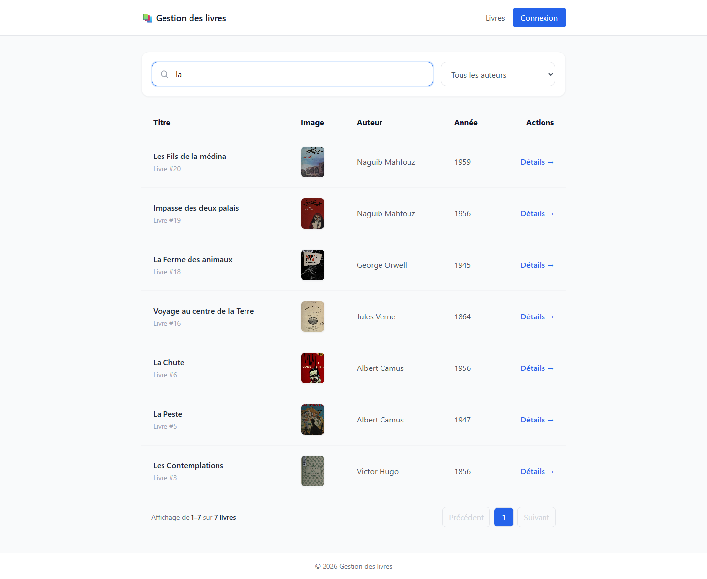

*Recherche « la » dans le titre : 7 résultats.*

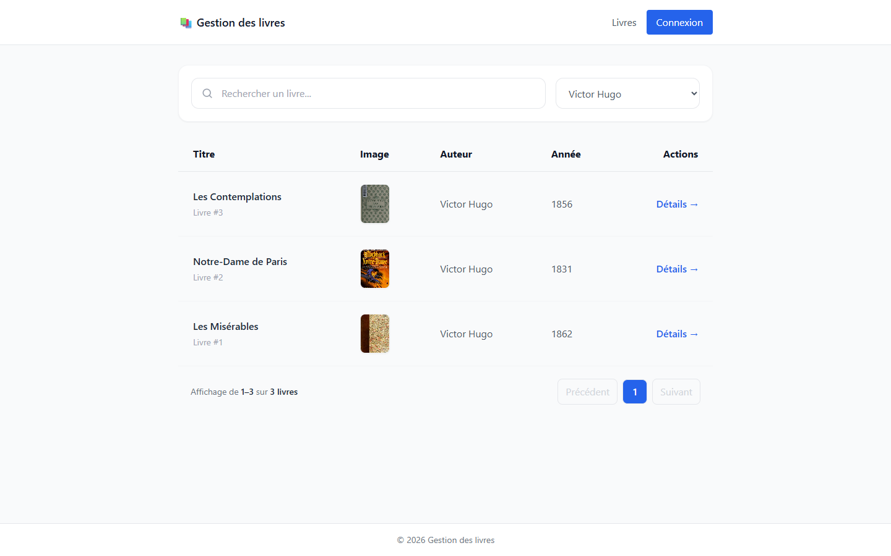

*Filtre « Victor Hugo » : 3 résultats.*

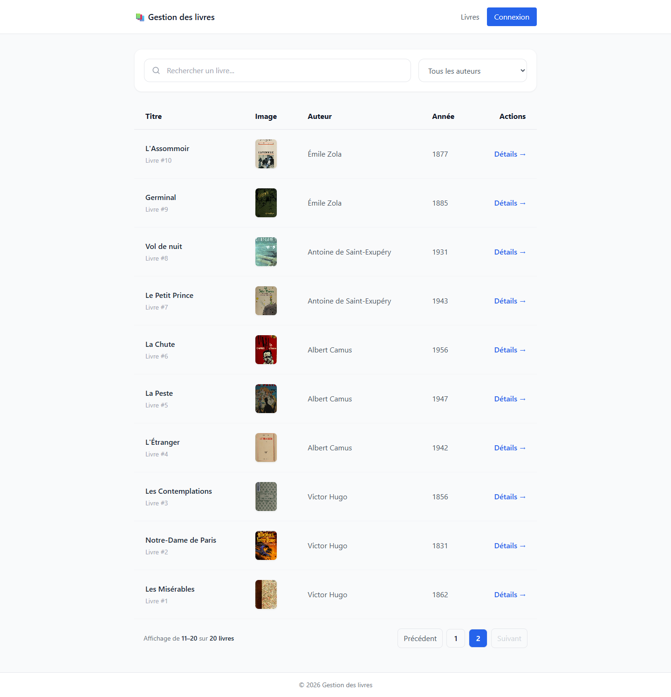

*Page 2 : livres 11 à 20 sur 20.*

### 10.4 Interface administrateur

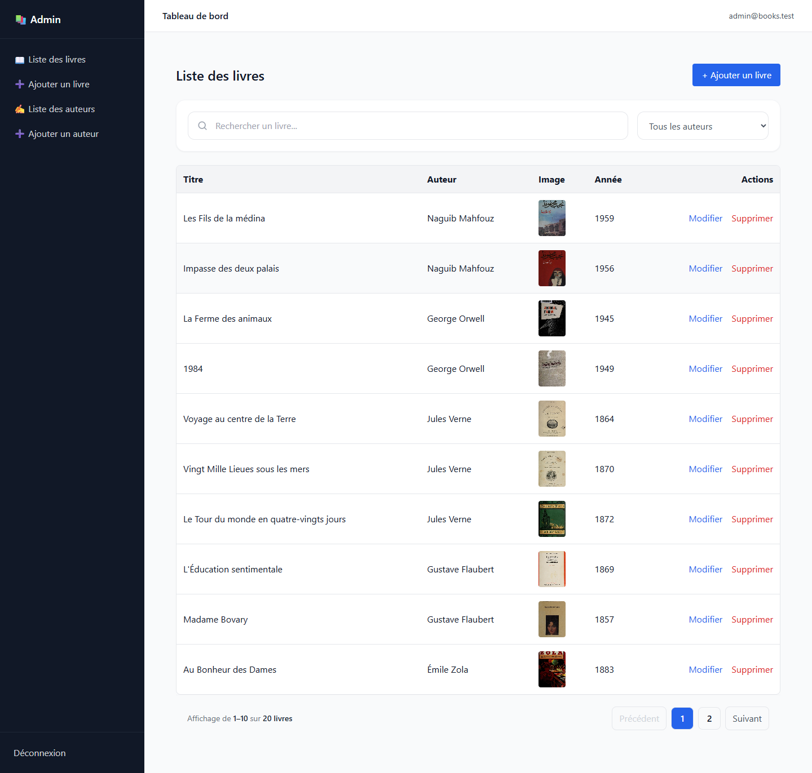

*`/admin/books` : page affichée directement après la connexion admin. Elle contient la barre latérale, la recherche, le filtre, la pagination et les actions Modifier / Supprimer.*

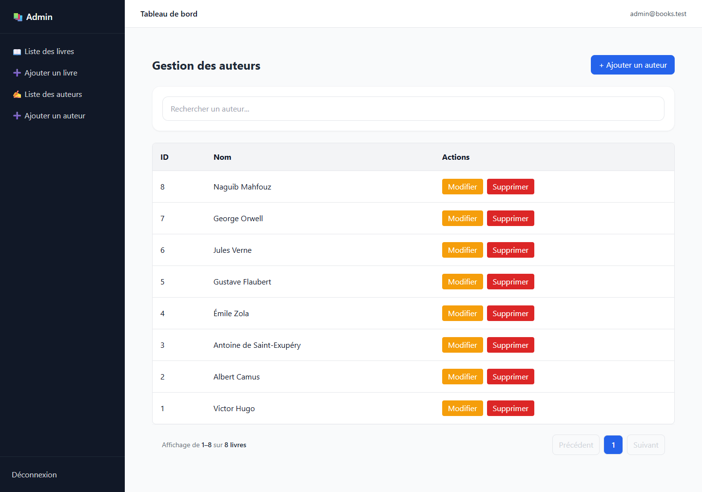

*`/admin/authors` : recherche par nom, pagination côté frontend, actions Modifier / Supprimer.*

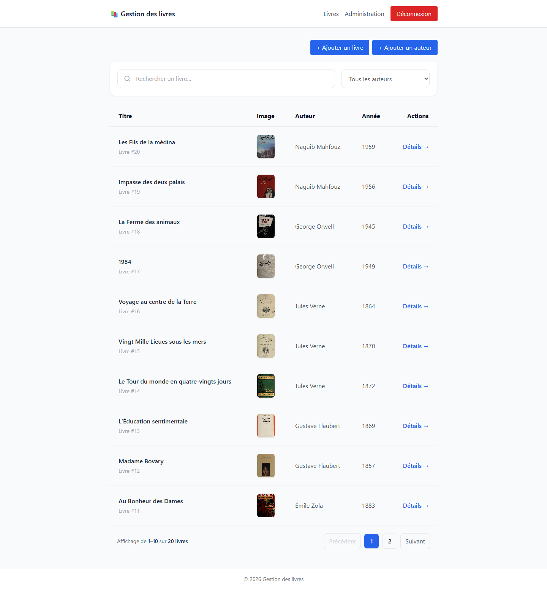

*`/books` vu par l'admin : boutons « + Ajouter un livre » et « + Ajouter un auteur », lien « Administration » dans la navbar.*

### 10.5 Formulaire d'ajout

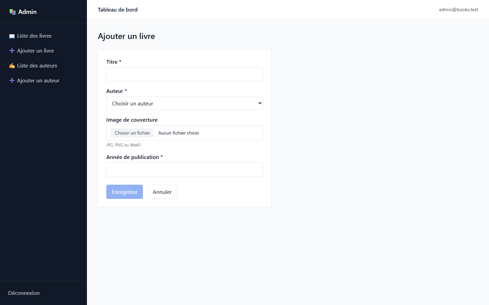

*`/admin/books/new` : le bouton « Enregistrer » reste désactivé tant que les champs obligatoires sont vides.*

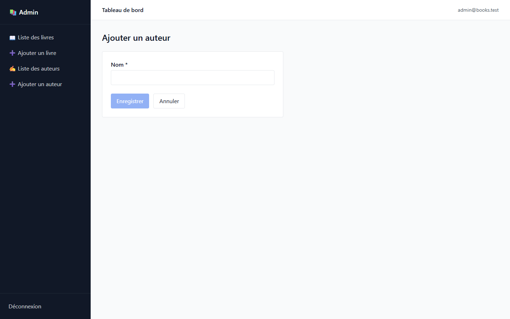

*`/admin/authors/new`.*

### 10.6 Formulaire de modification

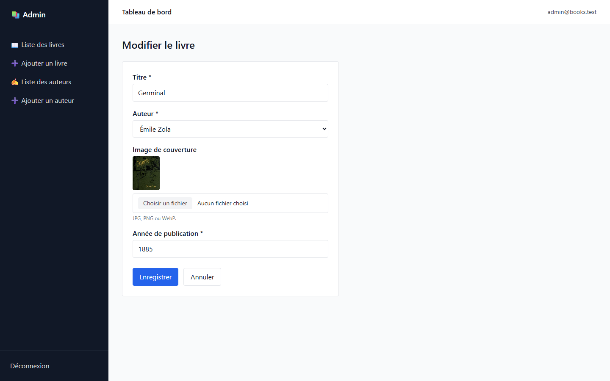

*`/admin/books/9/edit` : le formulaire est pré-rempli avec les anciennes données de « Germinal » (titre, auteur, année), et la couverture actuelle est affichée.*

### 10.7 Défauts visibles sur les captures

- L'en-tête admin affiche `admin@books.test`, écrit en dur dans `admin-layout.component.html`, et non l'email de l'utilisateur connecté.
- Sur `/admin/authors`, la pagination affiche « sur 8 **livres** » au lieu de « 8 auteurs » : le texte « livres » est écrit en dur dans `pagination.component.html`.
- Le bandeau « Connectez-vous pour voir les détails du livre. » s'affiche sur `/login` même quand on n'arrive pas depuis un livre.

### 10.8 Consulter et refaire les captures

- **Consulter :** ouvrez ce README sur GitHub ou GitLab, dans l'aperçu Markdown de VS Code (`Ctrl + Maj + V`), ou ouvrez directement les fichiers `.png` de `docs/screenshots/`.
- **Refaire une capture :** lancez l'application, ouvrez la page, prenez la capture (`Windows + Maj + S`) et enregistrez-la sous le même nom dans `docs/screenshots/`.

---

## 11. Dépannage

### Base de données

| Erreur | Cause | Solution |
|---|---|---|
| `SQLSTATE[HY000] [1049] Unknown database 'book-shop'` | Base non créée | Créez la base `book-shop` |
| `SQLSTATE[HY000] [2002] No connection could be made` | MySQL arrêté | Démarrez MySQL (XAMPP ou Laragon) |
| `SQLSTATE[HY000] [1045] Access denied` | Identifiants faux | Vérifiez `DB_USERNAME` et `DB_PASSWORD` |
| `could not find driver` | Extension manquante | Activez `extension=pdo_mysql` dans `php.ini` |
| `Duplicate entry 'admin@gmail.com'` lors de `db:seed` | L'admin existe déjà | Lancez seulement `php artisan db:seed --class=BookSeeder` |

### Configuration `.env`

| Problème | Solution |
|---|---|
| `No application encryption key has been specified.` | `php artisan key:generate` |
| Changement du `.env` sans effet | `php artisan config:clear` puis relancer `php artisan serve` |
| Images des livres non affichées (404) | `php artisan storage:link`, et vérifiez que `APP_URL=http://127.0.0.1:8000` |
| Upload d'image refusé | Activez `extension=fileinfo` ; formats acceptés : JPG, PNG, WebP, 2 Mo maximum |

### CORS

`config/cors.php` autorise toutes les origines (`allowed_origins => ['*']`) pour `api/*`. Le token passe par l'en-tête `Authorization`, pas par un cookie envoyé à l'API, donc `supports_credentials => false` suffit.

| Erreur | Cause | Solution |
|---|---|---|
| `blocked by CORS policy` | Le backend ne tourne pas, ou l'URL est fausse | Vérifiez `php artisan serve` et `api.config.ts` |
| `blocked by CORS policy` sur une erreur 500 | Erreur PHP avant la réponse | Lisez `storage/logs/laravel.log` |

### Authentification

| Problème | Cause | Solution |
|---|---|---|
| `401 Unauthenticated.` | Token absent, ou supprimé après `migrate:fresh` | Déconnectez-vous puis reconnectez-vous |
| `403 Forbidden. Admin access required.` | L'utilisateur n'a pas `role = admin` | Voir [4](#4-compte-administrateur) |
| `Email address is not verified.` | Code OTP non validé | Validez le code sur `/verify-email`, ou utilisez `MAIL_MAILER=log` pour lire le code |
| Boutons admin absents | Cookie `role` absent (connexion Google, ou ancienne session) | Déconnexion puis connexion par email et mot de passe |
| Déconnecté sans raison | Cookies créés sur `127.0.0.1:4200` puis ouverture de `localhost:4200` (ou l'inverse) | Utilisez toujours `http://localhost:4200` |

### OAuth et SMTP

Voir [6.6](#66-dépannage-oauth) et [7.4](#74-diagnostic-des-erreurs).

### Frontend

| Problème | Solution |
|---|---|
| `'ng' n'est pas reconnu` | Utilisez `npm start` ou `npx ng serve` |
| Port 4200 déjà utilisé | `npx ng serve --port 4300`. La connexion Google redirige toujours vers 4200 |
| Erreurs après `git pull` | Supprimez `node_modules` puis relancez `npm install` |

---

## 12. Livraison

### 12.1 Structure du projet

```
gestion de livre/
├── README.md
├── docs/                              MCD (PDF + source) et captures d'écran
├── exports/
│   └── book-shop.sql                  Export SQL de la base (structure + données)
├── books-api/                         Backend Laravel
│   ├── .env.example                   Modèle de configuration
│   ├── app/
│   │   ├── Exceptions/                Exceptions métier + Handler.php
│   │   ├── Http/
│   │   │   ├── Controllers/Api/       Auth, Book, Author, GoogleAuth...
│   │   │   ├── Middleware/IsAdmin.php
│   │   │   ├── Requests/              Règles de validation
│   │   │   └── Resources/             Format JSON (BookResource, AuthorResource)
│   │   ├── Mail/                      Emails OTP
│   │   ├── Models/                    User, Book, Author
│   │   ├── Policies/                  BookPolicy, AuthorPolicy
│   │   └── Services/                  Logique métier
│   ├── config/                        cors.php, services.php, sanctum.php...
│   ├── database/
│   │   ├── migrations/
│   │   └── seeders/                   AdminSeeder, BookSeeder, DatabaseSeeder
│   ├── routes/
│   │   ├── api.php                    Routes /api
│   │   └── web.php                    Routes Google OAuth
│   └── storage/app/public/books/      Images des livres
└── books-front/                       Frontend Angular
    └── src/app/
        ├── app.routes.ts              Routes Angular
        ├── app.config.ts              HttpClient + interceptor
        ├── core/
        │   ├── config/api.config.ts   URL de l'API
        │   ├── interceptors/          auth.interceptor.ts
        │   └── services/              auth, book, author
        ├── guards/                    auth.guard.ts, admin.guard.ts
        ├── layouts/                   public-layout, admin-layout
        ├── pages/                     login, register, book-list, admin/...
        ├── shared/                    navbar, footer, search, pagination
        └── types/                     Interfaces TypeScript
```

### 12.2 Fichiers importants

| Fichier | Rôle |
|---|---|
| `books-api/routes/api.php` | Toutes les routes de l'API |
| `books-api/app/Services/BookService.php` | Filtres, pagination, gestion des images |
| `books-api/app/Models/User.php` | Attribut `is_admin` |
| `books-api/app/Http/Controllers/Api/GoogleAuthController.php` | Connexion Google |
| `books-api/database/seeders/` | Admin et données de démonstration |
| `books-front/src/app/app.routes.ts` | Routes et guards |
| `books-front/src/app/core/services/auth.service.ts` | Cookies `token` et `role` |
| `books-front/src/app/core/config/api.config.ts` | Adresse de l'API |

### 12.3 Commandes de démarrage

Terminal 1 (backend) :

```bash
cd books-api
php artisan serve
```

Terminal 2 (frontend) :

```bash
cd books-front
npm start
```

Ensuite, ouvrez http://localhost:4200.

### 12.4 Secrets et Git

- `books-api/.gitignore` exclut `.env`, `.env.backup`, `.env.production`, `/vendor` et `/public/storage`.
- `books-front/.gitignore` exclut `/node_modules` et `/dist`. Le frontend ne contient pas de fichier `.env`.
- Seul `books-api/.env.example` est à partager, avec des valeurs d'exemple uniquement.
- Le dossier `books-api` n'est pas encore un dépôt Git (seul `books-front` en est un). Après un `git init`, vérifiez avec `git status` que `.env` n'apparaît pas.

### 12.5 Checklist finale

- [ ] `composer install` et `npm install` passent sans erreur.
- [ ] `books-api/.env` est créé à partir de `.env.example` et `php artisan key:generate` est lancé.
- [ ] La base `book-shop` existe, et elle est remplie soit par `php artisan migrate` + `php artisan db:seed`, soit par l'import de `exports/book-shop.sql`.
- [ ] `php artisan storage:link` est lancé et les images s'affichent.
- [ ] Connexion admin OK (`admin@gmail.com`) avec redirection vers `/admin`.
- [ ] Ajout, modification et suppression d'un livre et d'un auteur OK.
- [ ] Recherche, filtre par auteur et pagination OK sur `/books` et `/admin/books`.
- [ ] Inscription + email OTP reçu + vérification OK (SMTP configuré).
- [ ] Mot de passe oublié OK.
- [ ] Connexion Google OK (Client ID, Secret et URI de redirection configurés).
- [ ] Aucun vrai secret dans `.env.example`, le README ou Git.
- [x] Captures d'écran ajoutées dans `docs/screenshots/`.

### 12.6 Limites connues

| Limite | Détail |
|---|---|
| Rôle non transmis par Google | Un admin connecté par Google n'a pas accès à l'administration |
| Pas d'appel API à la déconnexion | Le token reste valide en base |
| Pas de route « utilisateur connecté » | Le rôle est gardé uniquement dans un cookie côté navigateur |
| Erreurs métier en 500 | Connexion, mot de passe oublié, livres, auteurs (voir [9.3](#93-codes-de-réponse)) |
| `AdminSeeder` non relançable | Erreur de doublon si l'admin existe déjà |
| Compte créé même si l'email échoue | Impossible de se réinscrire avec le même email sans le supprimer |
| Pas de bouton « Renvoyer le code » | Il faut attendre ou recommencer |
| Erreur Google non affichée | `?error=google_account_conflict` n'est pas affiché sur `/login` |
| Page `/reset-password-otp` inutilisée | Le parcours passe directement par `/reset-password` |
| Adresses écrites en dur | `127.0.0.1:8000` et `localhost:4200` dans le code Angular et dans `GoogleAuthController` |
| Pas de mise en ligne documentée | Le projet est prévu pour un usage local |

---

## 13. Gestion des rôles et des permissions

Cette section décrit uniquement ce qui est réellement implémenté dans le code.

### 13.1 Rôles existants

Il existe **deux rôles**, définis par la colonne `users.role` (migration `create_users_table`) :

```php
$table->enum('role', ['admin', 'user'])->default('user');
```

| Rôle | Objectif | Comment on l'obtient |
|---|---|---|
| `user` | Consulter le catalogue et le détail des livres | Rôle par défaut à l'inscription (`/register`) ou à la première connexion Google |
| `admin` | Gérer le catalogue : livres et auteurs | Uniquement par `AdminSeeder` (`admin@gmail.com`) ou par une modification directe en base (voir [4](#4-compte-administrateur)) |

En plus de ces deux rôles, le tableau ci-dessous mentionne le **visiteur** (personne non connectée). Ce n'est **pas un rôle** du code : c'est simplement l'absence de token.

> Il n'existe aucune page ni route API pour changer le rôle d'un utilisateur ou gérer les utilisateurs.

### 13.2 Tableau des permissions : livres

| Rôle | Consulter les livres | Ajouter | Modifier | Supprimer | Accès administration |
|---|---|---|---|---|---|
| Visiteur (non connecté) | ✅ Liste, recherche, filtre, pagination<br>❌ Détail d'un livre | ❌ | ❌ | ❌ | ❌ |
| `user` (connecté, email vérifié) | ✅ Liste + ✅ détail (`/books/:id`) | ❌ (403) | ❌ (403) | ❌ (403) | ❌ (redirection vers `/books`) |
| `admin` (connecté, email vérifié) | ✅ Liste + ✅ détail | ✅ | ✅ | ✅ | ✅ (`/admin`) |

### 13.3 Tableau des permissions : auteurs

| Rôle | Consulter la liste | Consulter un auteur (`GET /authors/{id}`) | Ajouter | Modifier | Supprimer |
|---|---|---|---|---|---|
| Visiteur | ✅ (`GET /authors` est public) | ❌ (401) | ❌ | ❌ | ❌ |
| `user` | ✅ | ❌ (403) | ❌ (403) | ❌ (403) | ❌ (403) |
| `admin` | ✅ | ✅ | ✅ | ✅ | ✅ (⚠️ supprime aussi tous ses livres) |

### 13.4 Conditions pour chaque action (backend Laravel)

| Action | Route API | Conditions vérifiées par Laravel |
|---|---|---|
| Lister les livres | `GET /api/books` | Aucune (publique) |
| Lister les auteurs | `GET /api/authors` | Aucune (publique) |
| Voir un livre | `GET /api/books/{book}` | `auth:sanctum` : token valide |
| Voir un auteur | `GET /api/authors/{author}` | `auth:sanctum` + `is_admin` |
| Ajouter un livre | `POST /api/books` | `auth:sanctum` + `is_admin` + `BookPolicy::create` + validation `StoreBookRequest` |
| Modifier un livre | `PUT /api/books/{book}` | `auth:sanctum` + `is_admin` + `BookPolicy::update` + validation `UpdateBookRequest` |
| Supprimer un livre | `DELETE /api/books/{book}` | `auth:sanctum` + `is_admin` + `BookPolicy::delete` |
| Ajouter / modifier / supprimer un auteur | `POST`, `PUT`, `DELETE /api/authors...` | `auth:sanctum` + `is_admin` + `AuthorPolicy` + validation |
| Se déconnecter | `POST /api/logout` | `auth:sanctum` |

Les actions d'écriture sont donc protégées **deux fois** côté backend :

1. **Middleware `is_admin`** (`app/Http/Middleware/IsAdmin.php`) sur le groupe de routes admin dans `routes/api.php`. Il répond `403 Forbidden. Admin access required.` si `$request->user()->is_admin` est faux.
2. **Policies** `BookPolicy` et `AuthorPolicy`, appelées par `Gate::authorize(...)` dans les contrôleurs. `create`, `update` et `delete` renvoient `$user->is_admin`, tandis que `viewAny` et `view` renvoient toujours `true`.

`is_admin` n'est pas une colonne : c'est un attribut calculé dans `app/Models/User.php` (`getIsAdminAttribute()`), qui vaut `true` si `role === 'admin'`. Le rôle est donc relu **en base à chaque requête**.

Les `FormRequest` (`StoreBookRequest`, `UpdateBookRequest`, `StoreAuthorRequest`, `UpdateAuthorRequest`) renvoient `authorize(): true`. Elles ne contrôlent que les données, pas les droits.

**Vérification de l'email :**

- La connexion par mot de passe est refusée tant que `email_verified_at` est vide (`LoginService` → `Email address is not verified.`).
- Un compte Google est considéré comme vérifié dès sa création.
- Le middleware Laravel `verified` existe dans `Kernel.php` mais **n'est appliqué à aucune route**. La vérification se fait uniquement au moment de la connexion.

### 13.5 Restrictions côté frontend Angular

| Élément | Fichier | Règle |
|---|---|---|
| Rôle stocké | `core/services/auth.service.ts` | Cookie `role` créé à la connexion par mot de passe, à partir de `response.user.role` |
| `isLoggedIn()` | `auth.service.ts` | Vrai si le cookie `token` existe (le token n'est pas vérifié auprès de l'API) |
| `isAdmin()` | `auth.service.ts` | Vrai si le cookie `role` vaut `admin` |
| `authGuard` | `guards/auth.guard.ts` | Protège `/books/:id` ; sinon redirection vers `/login` |
| `adminGuard` | `guards/admin.guard.ts` | Protège tout `/admin/...` ; sinon `/login` (non connecté) ou `/books` (non admin) |
| Interceptor | `core/interceptors/auth.interceptor.ts` | Ajoute `Authorization: Bearer <token>` à chaque requête |
| Navbar | `shared/navbar/navbar.component.html` | Lien « Administration » visible si `isAdmin()` ; « Déconnexion » si `isLoggedIn()`, sinon « Connexion » |
| Page `/books` | `pages/book-list/book-list.component.html` | Boutons « + Ajouter un livre » et « + Ajouter un auteur » visibles si `isAdmin()` |
| Après connexion | `pages/login/login.component.ts` | Redirection vers `/admin` si `isAdmin()`, sinon vers `/books` |

### 13.6 Pages accessibles selon le rôle

| Page Angular | Visiteur | `user` | `admin` |
|---|---|---|---|
| `/books` (liste, recherche, filtre, pagination) | ✅ | ✅ | ✅ (+ boutons d'ajout) |
| `/books/:id` (détail) | ❌ → `/login` | ✅ | ✅ |
| `/login`, `/register`, `/verify-email`, `/forgot-password`, `/reset-password` | ✅ | ✅ | ✅ |
| `/admin/books`, `/admin/books/new`, `/admin/books/:id/edit` | ❌ → `/login` | ❌ → `/books` | ✅ |
| `/admin/authors`, `/admin/authors/new`, `/admin/authors/:id/edit` | ❌ → `/login` | ❌ → `/books` | ✅ |

### 13.7 Backend ou frontend : qui protège quoi ?

| Restriction | Backend (Laravel) | Frontend (Angular) |
|---|---|---|
| Ajouter, modifier, supprimer un livre ou un auteur | ✅ `is_admin` + Policy | ✅ pages `/admin` + boutons cachés |
| Voir le détail d'un livre | ✅ `auth:sanctum` | ✅ `authGuard` |
| Voir un auteur par id | ✅ `auth:sanctum` + `is_admin` | ✅ `adminGuard` |
| Afficher les pages `/admin` | — (ce sont des pages Angular) | ✅ `adminGuard`, basé **uniquement sur le cookie `role`** |
| Liste des livres et des auteurs | Publique | Publique |

**Aucune action d'écriture n'est protégée uniquement par le frontend.** Si un utilisateur `user` modifie son cookie `role` en `admin` :

- il peut **afficher** les pages `/admin`, qui ne lisent que des données déjà publiques (`GET /books` et `GET /authors`) ;
- tous ses enregistrements ou suppressions sont **refusés par l'API (403)** ;
- le formulaire de modification d'un auteur ne se remplit pas, car `GET /api/authors/{id}` est réservé à l'admin.

### 13.8 Incohérences et risques détectés

| # | Problème | Conséquence |
|---|---|---|
| 1 | Le rôle côté Angular vient d'un **cookie modifiable** par l'utilisateur, jamais revérifié auprès de l'API | Un `user` peut afficher l'interface admin (sans pouvoir rien modifier : l'API répond 403) |
| 2 | La connexion **Google** ne transmet pas le rôle (pas de cookie `role`) | Un admin connecté par Google est traité comme `user` par Angular, alors que l'API accepterait ses actions admin |
| 3 | Pas de route du type `GET /api/user` | Si le rôle change en base, Angular ne le sait qu'à la prochaine connexion (le cookie dure 1 jour) |
| 4 | `GET /api/authors` est public, mais `GET /api/authors/{id}` est réservé à l'admin | Incohérence sans risque (la liste publique contient déjà les mêmes données) |
| 5 | Le middleware `verified` n'est appliqué à aucune route | La vérification de l'email ne dépend que de `LoginService` au moment de la connexion |
| 6 | La déconnexion Angular n'appelle pas `POST /api/logout` | Le token reste valide en base, et Sanctum n'a pas d'expiration (`expiration => null`) |
| 7 | `isLoggedIn()` ne vérifie que la présence du cookie `token` | Un token supprimé en base laisse passer les guards ; l'API répond alors 401 et la page affiche une erreur |
| 8 | Supprimer un auteur supprime tous ses livres (`ON DELETE CASCADE`) | Action admin destructive ; Angular demande une confirmation sans préciser que les livres seront supprimés |

### 13.9 Résumé

- **Visiteur :** voit la liste des livres, avec recherche, filtre et pagination. Ne voit pas le détail d'un livre et ne peut rien modifier.
- **`user` :** comme le visiteur, et peut en plus voir le détail d'un livre. Toutes les actions d'ajout, de modification et de suppression sont refusées par l'API (403), et `/admin` le renvoie vers `/books`.
- **`admin` :** accès complet. Ajoute, modifie et supprime livres et auteurs, et accède à l'interface `/admin`. Il doit pour cela se connecter par email et mot de passe, car avec Google l'interface admin n'est pas affichée.
